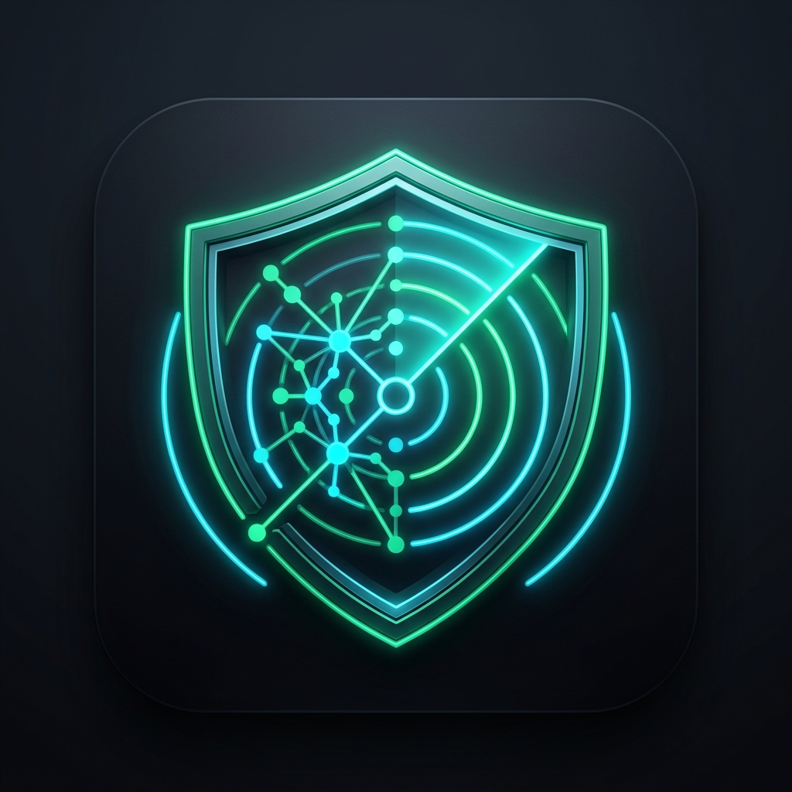

<div align="center">
  
  <h1>Brenducate</h1>
  <p><strong>Autonomous AI Agent Observability, Prompt Regression Sentinel & Sub-Millisecond Circuit Breakers</strong></p>
  <p>Protecting engineering teams from runaway token spend, infinite loops, and silent hallucinations in production LLM agents.</p>
</div>

---

## ⚡ Quick Start (Run Entire Stack in 1 Command)

```bash
# Clone and launch both backend (port 8000) & dashboard (port 3032)
python3 start.py
```

- 📊 **Dashboard UI**: [http://localhost:3032/index.html](http://localhost:3032/index.html)
- ⚡ **Telemetry API**: [http://localhost:8000](http://localhost:8000)
- 📚 **Swagger Docs**: [http://localhost:8000/docs](http://localhost:8000/docs)

---

## 📦 Python SDK Installation

```bash
pip install agentpulse-sdk
# or install locally from source:
pip install -e sdk/
```

### 1. Plain Python Agent (`@pulse.monitor`)

```python
from agentpulse import AgentPulse, CircuitBreaker

pulse = AgentPulse(api_key="ap_live_...")

@pulse.monitor(
    agent_id="customer-support-copilot",
    model="claude-3-7-sonnet",
    circuit_breaker=CircuitBreaker(
        max_hops=6,                     # Abort if agent loops > 6 hops
        max_cost_usd=0.50,              # Kill if run exceeds $0.50
        kill_on_infinite_loop=True,     # Kill repetitive duplicate tool calls
        max_duplicate_calls=2
    )
)
def run_my_agent(user_query: str):
    # If the agent attempts a runaway recursive loop, CircuitBreakerException
    # is raised in <1ms, killing the run and logging the incident to your dashboard!
    return "Resolved query."
```

### 2. 1-Line OpenAI Client Auto-Wrap

```python
from openai import OpenAI
from agentpulse import AgentPulse, CircuitBreaker, wrap_openai

pulse = AgentPulse(api_key="ap_live_...")

# Automatically tracks tokens, cost, latency, and enforces circuit breakers
client = wrap_openai(OpenAI(), pulse=pulse, agent_id="openai-analyst")

response = client.chat.completions.create(
    model="gpt-4o",
    messages=[{"role": "user", "content": "Analyze semiconductor supply chains"}]
)
```

### 3. LangChain / LangGraph Handler

```python
from agentpulse import AgentPulse, CircuitBreaker
from agentpulse.integrations.langchain import AgentPulseCallbackHandler
from langchain.agents import AgentExecutor

pulse = AgentPulse(api_key="ap_live_...")

handler = AgentPulseCallbackHandler(
    pulse=pulse,
    agent_id="research-langchain-agent",
    circuit_breaker=CircuitBreaker(max_hops=8, max_cost_usd=0.75)
)

executor = AgentExecutor(agent=agent, tools=tools, callbacks=[handler])
result = executor.invoke({"input": "Generate competitor matrix"})
```

---

## 🛡️ Circuit Breakers & Guardrails

| Guardrail | Trigger Parameter | Default | Behavior |
| :--- | :--- | :--- | :--- |
| **Infinite Recursion** | `kill_on_infinite_loop` | `True` | Intercepts repetitive duplicate queries with zero parameter change. |
| **Single-Run Cost Ceiling** | `max_cost_usd` | `$1.00` | Calculates token spend against live model pricing; aborts if budget is breached. |
| **Max Hops Boundary** | `max_hops` | `8` | Aborts run if total reasoning steps / tool calls exceeds limit. |
| **Duplicate Tolerance** | `max_duplicate_calls` | `2` | Consecutive identical tool calls allowed before termination. |

---

## 🧪 Testing

Run the full end-to-end automated test suite:

```bash
python3 tests/test_e2e.py
```

Run the live agent simulations:

```bash
python3 examples/demo_agent_run.py
python3 examples/openai_auto_instrumentation.py
```

---

## 🚀 1-Click Production Deployment

### Backend & Database (Render.com)
1. Fork or push this repository to GitHub.
2. In [Render.com](https://render.com), click **New +** -> **Blueprint**.
3. Select this repo. `render.yaml` automatically provisions:
   - Python FastAPI Edge Ingestion API
   - Managed PostgreSQL Database
   - Free SSL and environment variables

### Frontend Dashboard (Vercel / Cloudflare Pages)
1. Import the root directory into **Vercel** or **Cloudflare Pages**.
2. Deploy! `vercel.json` includes clean security headers and URL routing.

---

## 💳 Stripe Billing & $10k/Month Model

- Configured for 3 subscription tiers:
  - **Starter**: $49/mo (50k runs)
  - **Pro** *(Hero)*: $99/mo (500k runs, drift alerts, Slack)
  - **Scale**: $249/mo (2.5M runs, dedicated edge, SLA)
- To enable live payments:
  1. Add your `STRIPE_SECRET_KEY` and `STRIPE_WEBHOOK_SECRET` in `server/.env`.
  2. Point Stripe webhook to `https://your-api.onrender.com/v1/billing/webhook`.

---

## 📄 License
MIT License. Free to commercialize, self-host, and modify.
